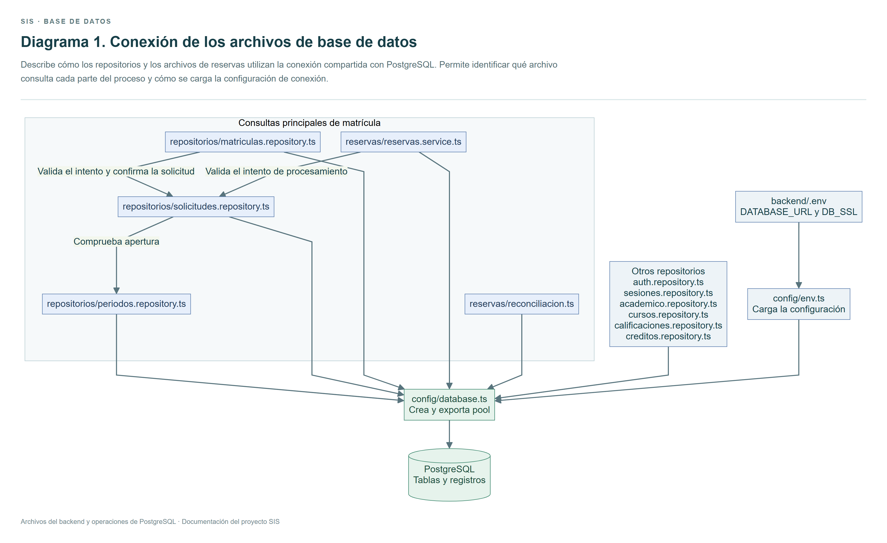
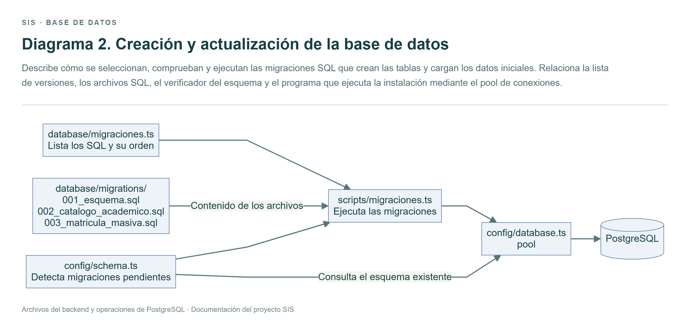
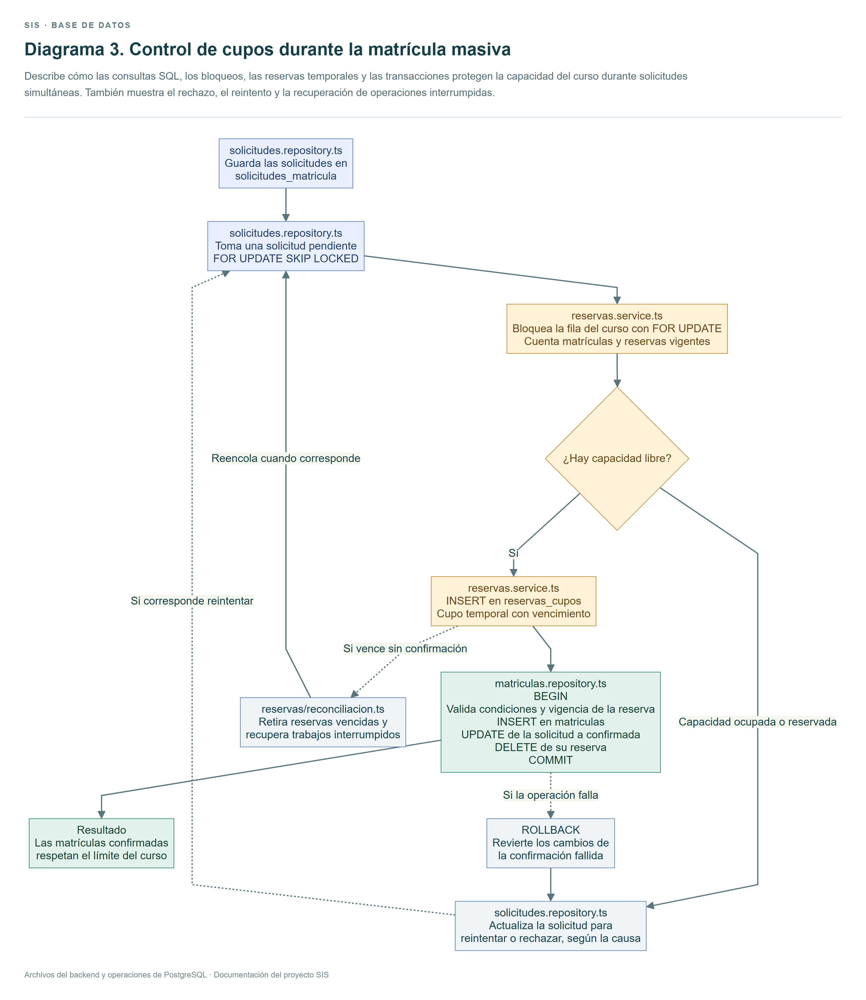

# SIS 2.0

Sistema de matrícula con solicitudes persistentes, procesamiento asíncrono, reservas atómicas y monitoreo.

La API y el worker usan PostgreSQL como cola duradera y almacén de reservas. Redis queda como una extensión opcional. El worker embebido se inicia con el backend durante el desarrollo.

## Ejecución

1. Ejecuta npm.cmd install y npm.cmd run install:all desde la raíz de SIS.
2. Configura backend/.env y frontend/.env a partir de sus ejemplos. Usa una base exclusiva como sistema_escolar_v2.
3. Desde backend ejecuta npm.cmd run db:migrate y npm.cmd run db:check.
4. Crea un administrador desde backend con npm.cmd run control-admin.
5. Desde la raíz de SIS ejecuta npm.cmd run dev.

La configuración de ejemplo usa la interfaz en http://localhost:5174 y la API en http://localhost:3001/api.

En el panel administrativo abre Apertura de matrícula, establece las fechas y habilita el periodo. Crea cursos con horarios y cupos desde Administración académica. Monitoreo en vivo muestra la actividad de la cola.

El estudiante entra a Matrícula masiva, envía solicitudes y consulta sus estados. La matrícula y el horario se actualizan al confirmar el trabajo.

## Comprobación

npm.cmd run build compila ambos proyectos.
npm.cmd test ejecuta las pruebas del backend y de la interfaz.
npm.cmd run test:carga compila el backend y ejecuta el escenario de carga sobre un esquema temporal.

Para un worker separado configura WORKER_EMBEBIDO=false en backend/.env, inicia la API y ejecuta npm.cmd run worker desde backend. En producción se puede usar npm.cmd run worker:prod después del build.

Consulta docs/arquitectura.md, docs/base-de-datos.md y docs/pruebas-de-rendimiento.md para estudiar la implementación y los resultados.

## Demostración visual

Entra como administrador y abre Demostración visual o /admin/simulacion. Elige estudiantes y cupos y pulsa Iniciar demostración. El servidor ejecuta el escenario real de carga en un esquema temporal y publica muestras del avance.

El modo exposición añade pausas de 40 ms para observar reservas y procesamiento. Desactívalo para medir la prueba sin esas pausas. Los tiempos incluyen la configuración elegida. El panel permite descargar el resultado y explica cada comprobación.

El proceso requiere permisos para crear esquemas y mantiene una sola demostración activa por base de datos. La API conserva el estado de la última demostración en memoria mientras siga ejecutándose.

## Diagramas de base de datos

1. **Conexión de los archivos de base de datos.** Explica cómo se conectan los repositorios, las reservas, la configuración y PostgreSQL. [Ver diagrama 1](docs/diagrama-base-de-datos.md).

   
2. **Creación y actualización de la base de datos.** Explica cómo se comprueban y ejecutan las migraciones SQL. [Ver diagrama 2](docs/diagrama-migraciones.md).

   
3. **Control de cupos durante la matrícula masiva.** Explica cómo los bloqueos, las reservas y las transacciones protegen los cupos y permiten recuperarse de fallos. [Ver diagrama 3](docs/diagrama-control-de-cupos.md).

   

## Monitorear una prueba de carga por terminal

Después de aplicar las migraciones, inicia la aplicación con npm.cmd run dev. Entra como administrador y abre Monitoreo en vivo. En una segunda terminal, desde la raíz de SIS, configura $env:CARGA_ESTUDIANTES='2000' y ejecuta npm.cmd run test:carga.

La sección Pruebas de carga desde la terminal muestra el avance, las confirmaciones, los rechazos y las métricas del proceso que ejecuta la prueba. Se actualiza cada dos segundos y permite consultar las últimas cinco ejecuciones de las últimas 24 horas. El resultado permanece después de retirar el esquema temporal.

La migración 004_telemetria_carga.sql crea el registro compartido en PostgreSQL. Si el proceso deja de publicar muestras durante veinte segundos, el panel avisa que se revise la terminal.
