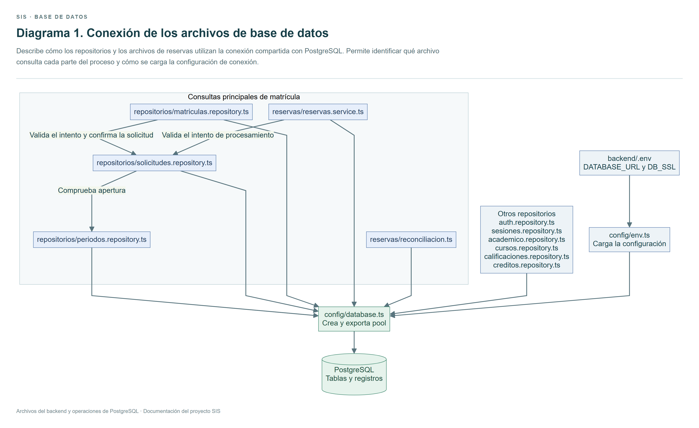
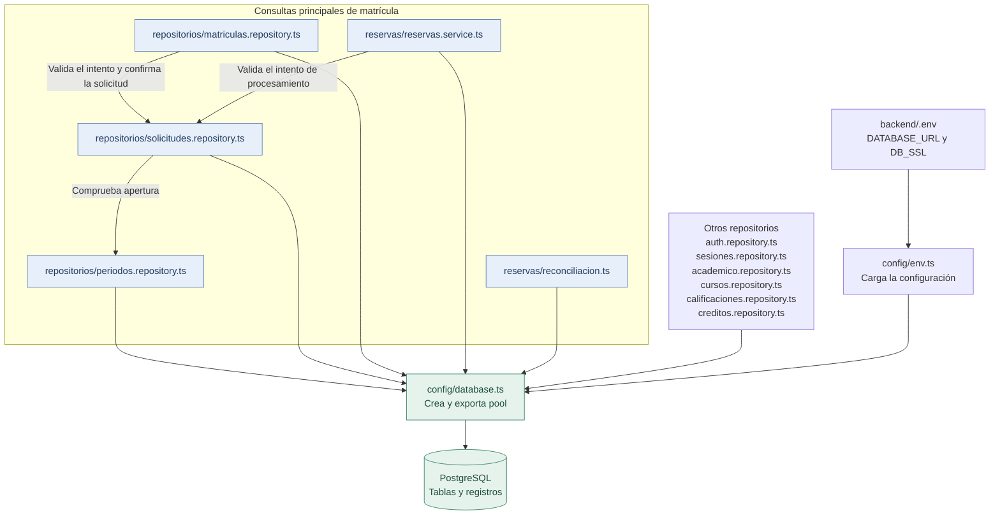

# Diagrama 1. Conexión de los archivos de base de datos

Describe cómo los repositorios y los archivos de reservas utilizan la conexión compartida con PostgreSQL. Permite identificar qué archivo consulta cada parte del proceso y cómo se carga la configuración de conexión.

Úsalo para presentar la organización de tu parte de base de datos antes de explicar las consultas.

## Conexión entre los archivos de consultas

Las flechas indican qué archivo utiliza a otro. Todos los accesos a PostgreSQL pasan por el pool definido en config/database.ts.

Ver el diagrama editable en Mermaid

Los nombres del diagrama son relativos a backend/src, salvo backend/.env.

## Qué debes explicar de los archivos principales

| Archivo | Qué hace en la base de datos |
| --- | --- |
| config/database.ts | Crea el pool que reutiliza conexiones con PostgreSQL |
| periodos.repository.ts | Consulta y guarda el periodo y comprueba su apertura |
| solicitudes.repository.ts | Inserta solicitudes, toma trabajos con SKIP LOCKED y actualiza estados |
| reservas.service.ts | Bloquea el curso, cuenta matrículas y reservas y crea una reserva temporal |
| matriculas.repository.ts | Consulta condiciones académicas y confirma la matrícula y la solicitud en una transacción |
| reconciliacion.ts | Recupera trabajos vencidos y retira reservas expiradas |

Las consultas de reservas están dentro de reservas.service.ts. Ese archivo forma parte de la explicación de SQL y protección de cupos.

La creación de las tablas se explica en el [diagrama de migraciones](diagrama-migraciones.md).

## Los otros repositorios

| Archivo | Datos que maneja |
| --- | --- |
| auth.repository.ts | Usuarios |
| sesiones.repository.ts | Sesiones de autenticación |
| academico.repository.ts | Facultades, carreras y pensums |
| cursos.repository.ts | Grupos, docentes, horarios y cupos |
| calificaciones.repository.ts | Notas y materias aprobadas |
| creditos.repository.ts | Resumen de créditos |

## Orden para la exposición

1. Mostrar los SQL y explicar las tablas principales.
2. Abrir config/database.ts y explicar el pool.
3. Mostrar cómo solicitudes.repository.ts guarda y toma una solicitud.
4. Mostrar cómo reservas.service.ts cuenta y reserva los cupos.
5. Mostrar cómo matriculas.repository.ts confirma los cambios con COMMIT o los revierte con ROLLBACK.
6. Explicar que reconciliacion.ts permite recuperar operaciones interrumpidas.

Los workers y los controladores llaman a estas operaciones desde el backend. En esta parte de la exposición se estudian la estructura, las consultas y las garantías de PostgreSQL.
