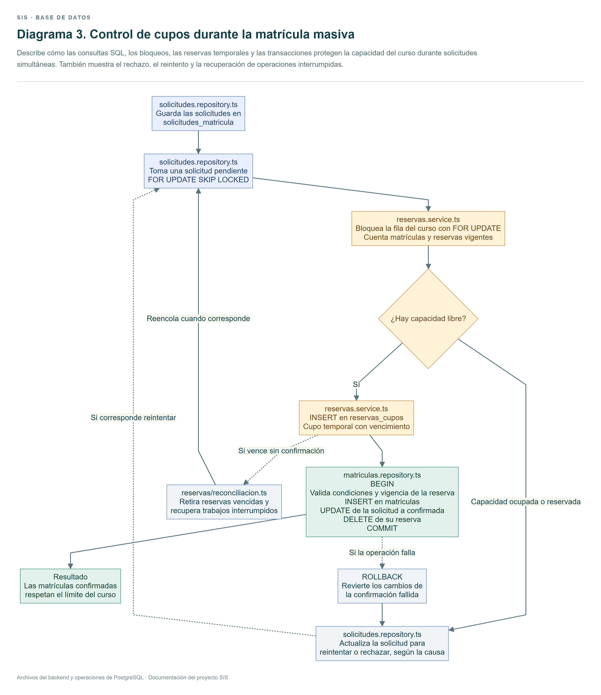
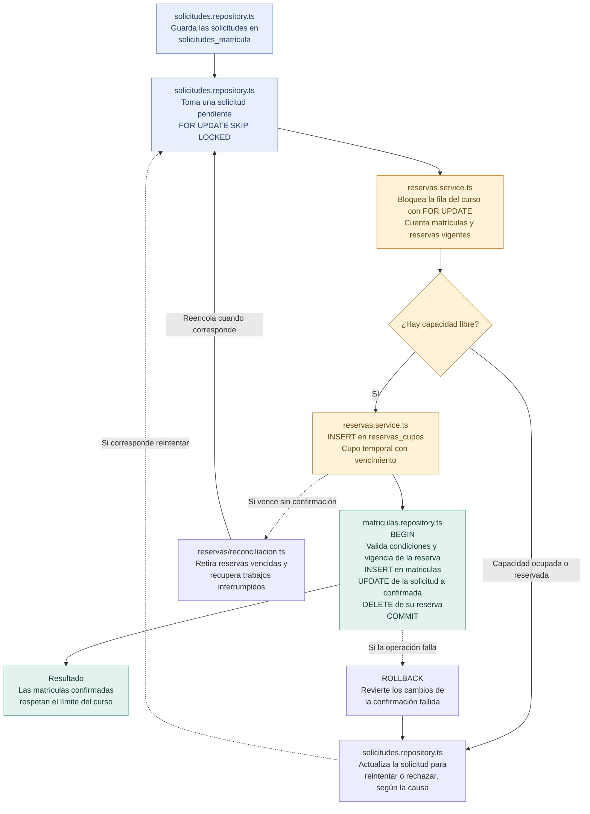

# Diagrama 3. Control de cupos durante la matrícula masiva

Describe cómo las consultas SQL, los bloqueos, las reservas temporales y las transacciones protegen la capacidad del curso durante solicitudes simultáneas. También muestra el rechazo, el reintento y la recuperación de operaciones interrumpidas.

Úsalo para explicar el objetivo principal del proyecto desde la base de datos.

El objetivo es que las solicitudes simultáneas respeten la capacidad del curso. Por ejemplo, si 2000 estudiantes compiten por 30 cupos, deben confirmarse como máximo 30 matrículas.

Las flechas muestran el flujo de operaciones de base de datos. Cada bloque identifica el archivo responsable de su SQL.

Ver el diagrama editable en Mermaid

El bloqueo de la fila del curso coordina el conteo de matrículas y reservas con la creación de nuevas reservas. SKIP LOCKED permite tomar trabajos distintos de la cola.

La matrícula, el estado confirmado de la solicitud y la eliminación de su reserva se guardan dentro de una misma transacción. Si la confirmación falla, ROLLBACK revierte sus cambios y el procesamiento registra el resultado o reintento.

La restricción UNIQUE de usuario, curso y periodo evita matrículas duplicadas. La capacidad se protege mediante el conteo bajo bloqueo y las comprobaciones de la transacción.

Las tablas principales son solicitudes_matricula, reservas_cupos, cursos y matriculas. Sus definiciones están en 001_esquema.sql y 003_matricula_masiva.sql.

Los bloqueos se liberan al cerrar la transacción. Las reservas son registros con vencimiento que pueden recuperarse después de un fallo.
