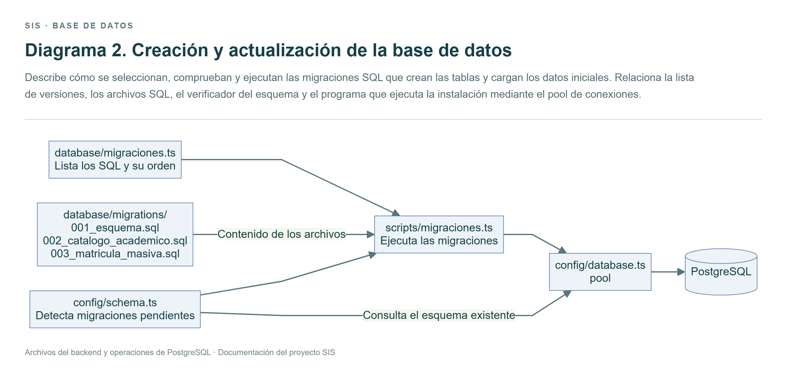
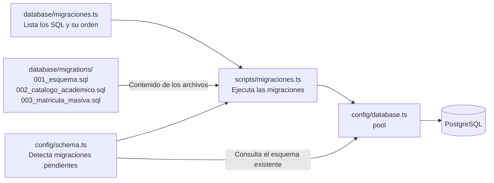

# Diagrama 2. Creación y actualización de la base de datos

Describe cómo se seleccionan, comprueban y ejecutan las migraciones SQL que crean las tablas y cargan los datos iniciales. Relaciona la lista de versiones, los archivos SQL, el verificador del esquema y el programa que ejecuta la instalación mediante el pool de conexiones.

Úsalo para explicar cómo se prepara PostgreSQL antes de utilizar la aplicación.

Ver el diagrama editable en Mermaid

## Responsabilidad de los archivos

| Archivo | Función |
| --- | --- |
| `database/migraciones.ts` | Define las versiones y su orden de aplicación |
| `scripts/migraciones.ts` | Lee y ejecuta las migraciones pendientes dentro de transacciones |
| `config/schema.ts` | Comprueba las tablas y las versiones instaladas |
| `config/database.ts` | Proporciona las conexiones con PostgreSQL |
| `001_esquema.sql` | Crea la estructura académica y sus restricciones |
| `002_catalogo_academico.sql` | Carga carreras, materias, pensums y prerrequisitos |
| `003_matricula_masiva.sql` | Agrega periodos, solicitudes, reservas y tablas auxiliares |

Los nombres son relativos a `backend/src`. Los archivos SQL están en `database/migrations`.

## Idea para la exposición

La lista indica qué migraciones existen. El verificador identifica cuáles faltan y el ejecutor aplica el SQL en orden. PostgreSQL conserva el registro de versiones en `sis_migraciones`.
