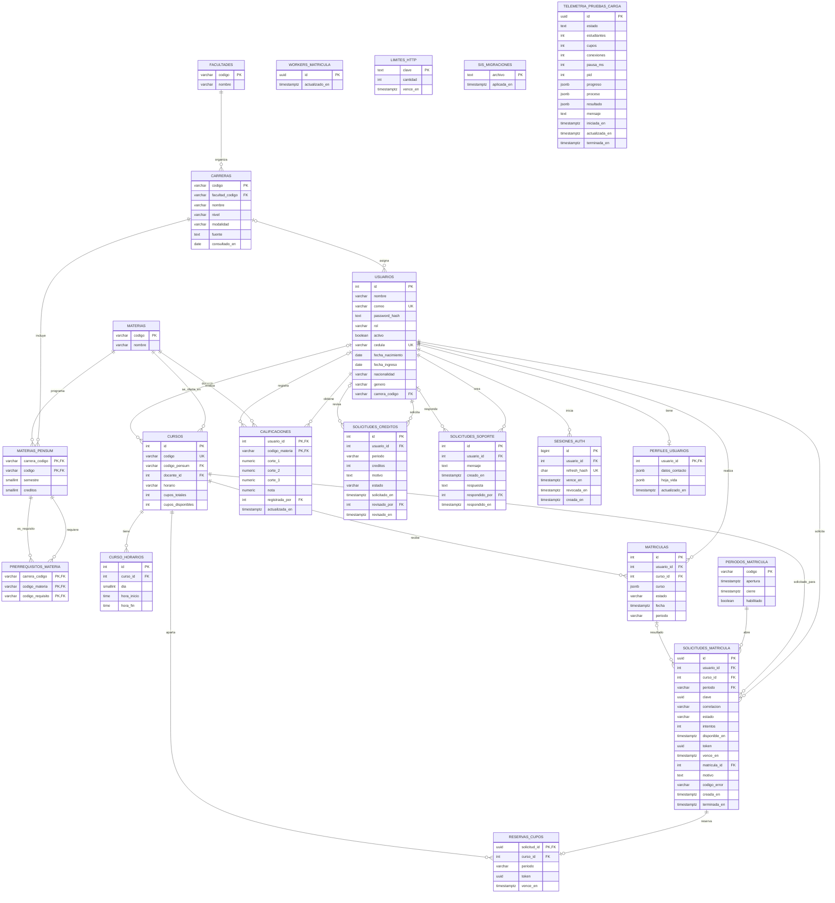

# Modelo relacional de PostgreSQL

Diagrama ER de las tablas definidas por las migraciones `001_esquema.sql`, `002_catalogo_academico.sql`, `003_matricula_masiva.sql` y `004_telemetria_carga.sql`. Las relaciones representan claves foráneas; los campos JSONB se muestran como datos embebidos y no como relaciones.

## Notas de lectura

- `MATERIAS_PENSUM` asocia cada materia con una carrera; su clave primaria es compuesta por `carrera_codigo` y `codigo`.
- `PRERREQUISITOS_MATERIA` tiene dos referencias a esa clave compuesta. Así un prerrequisito pertenece al mismo plan que la materia dependiente.
- `CALIFICACIONES` usa `(usuario_id, codigo_materia)` como clave primaria, por lo que hay una calificación final por materia y estudiante.
- `CURSOS.codigo_pensum` referencia `MATERIAS.codigo`; el servicio comprueba además que la materia pertenezca a la carrera del estudiante.
- `MATRICULAS.curso` es una copia JSONB del curso al momento de inscripción. La relación vigente se mantiene por `curso_id`.
- `SOLICITUDES_MATRICULA.periodo` referencia `PERIODOS_MATRICULA.codigo`. `MATRICULAS.periodo` y `RESERVAS_CUPOS.periodo` son valores de periodo sin clave foránea declarada.
- `WORKERS_MATRICULA`, `LIMITES_HTTP`, `SIS_MIGRACIONES` y `TELEMETRIA_PRUEBAS_CARGA` no tienen relaciones foráneas en estas migraciones.
