# Guía visual para explicar y modificar el Sistema Escolar

Esta guía sigue los nombres actuales del código. Está organizada para localizar una
funcionalidad, explicar su recorrido y decidir qué archivos cambiar durante una
pregunta del profesor. Los diagramas representan la lectura del código fuente.

## Índice de consulta

- [Cómo ubicar una pregunta](#cómo-ubicar-una-pregunta)
- [Arquitectura general](#arquitectura-general)
- [Autenticación y sesiones](#1-autenticación-y-sesiones)
- [Registro y administración de usuarios](#2-registro-y-administración-de-usuarios)
- [Facultades, carreras y pénsum](#3-facultades-carreras-y-pénsum)
- [Cursos, grupos y asignación docente](#4-cursos-grupos-y-asignación-docente)
- [Matrícula y consultas](#5-matrícula-y-consultas)
- [Créditos y solicitudes](#6-créditos-y-solicitudes)
- [Calificaciones y avance académico](#7-calificaciones-y-avance-académico)
- [Horarios](#8-horarios)
- [Datos personales y foto](#9-datos-personales-y-foto)
- [Soporte docente](#10-soporte-docente)
- [Navegación, roles y componentes](#11-navegación-roles-y-componentes)
- [Base de datos y configuración](#base-de-datos-y-configuración)
- [Simulacro de preguntas](#simulacro-de-preguntas)
- [Cómo comprobar un cambio](#cómo-comprobar-un-cambio)

## Cómo ubicar una pregunta

Identifica primero el verbo que usa el profesor y después la funcionalidad.

| Si dice algo como… | Parte que debes localizar primero |
| --- | --- |
| Cambia el texto, el botón o su posición | Vista `.vue` y sus componentes |
| Agrega una pantalla o cambia una dirección | `frontend/src/router/rutas/` |
| Cambia quién puede entrar o realizar una acción | Guard del router, middleware y validación del servicio |
| Cambia qué datos se envían | Archivo `.api.ts`, controlador y contrato de entrada |
| Cambia una condición, un límite o un cálculo | Servicio del dominio y validaciones del repositorio |
| Cambia lo que se consulta o guarda | Repositorio y, cuando cambia el esquema, migración |
| Algo aparece desactualizado | Estado de la vista, store, recarga y consulta SQL |
| Agrega un campo de extremo a extremo | Formulario → API → validación → persistencia → respuesta |

En VS Code, usa `Ctrl+P` para abrir un archivo por nombre y `Ctrl+Shift+F` para
buscar una función, un endpoint o un código de error. Si la pregunta menciona una
regla, busca también sus repeticiones en SQL y sus textos en la interfaz.

## Arquitectura general

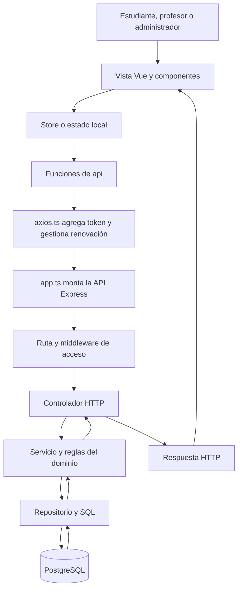

| Responsabilidad | Ubicación | Qué explicar |
| --- | --- | --- |
| Inicio de la interfaz | [main.ts](../frontend/src/main.ts) | Registra Vue, Pinia y el router |
| Pantallas | [views](../frontend/src/views) | Capturan acciones y muestran los resultados |
| Estado compartido | [stores](../frontend/src/stores) | Conserva sesión y catálogo de cursos en memoria |
| Peticiones HTTP | [api](../frontend/src/api) | Define endpoints y tipos de datos |
| Transporte común | [axios.ts](../frontend/src/api/axios.ts) | Configura URL, cookie, token y reintento ante 401 |
| Inicio del servidor | [server.ts](../backend/src/server.ts) | Comprueba el esquema y comienza a escuchar |
| Configuración Express | [app.ts](../backend/src/app.ts) | Instala middlewares y monta `/api` |
| Distribución de endpoints | [api.routes.ts](../backend/src/routes/api.routes.ts) | Monta las rutas de cada funcionalidad |
| Reglas y persistencia | [services](../backend/src/services) y [repositorios](../backend/src/repositorios) | Coordinan operaciones y acceden a PostgreSQL |

Algunos recorridos tienen menos capas. Soporte conecta controlador y repositorio.
Documentos consulta su repositorio desde la ruta y usa un servicio para construir
el PDF. Sigue el recorrido específico de cada sección.

## 1. Autenticación y sesiones

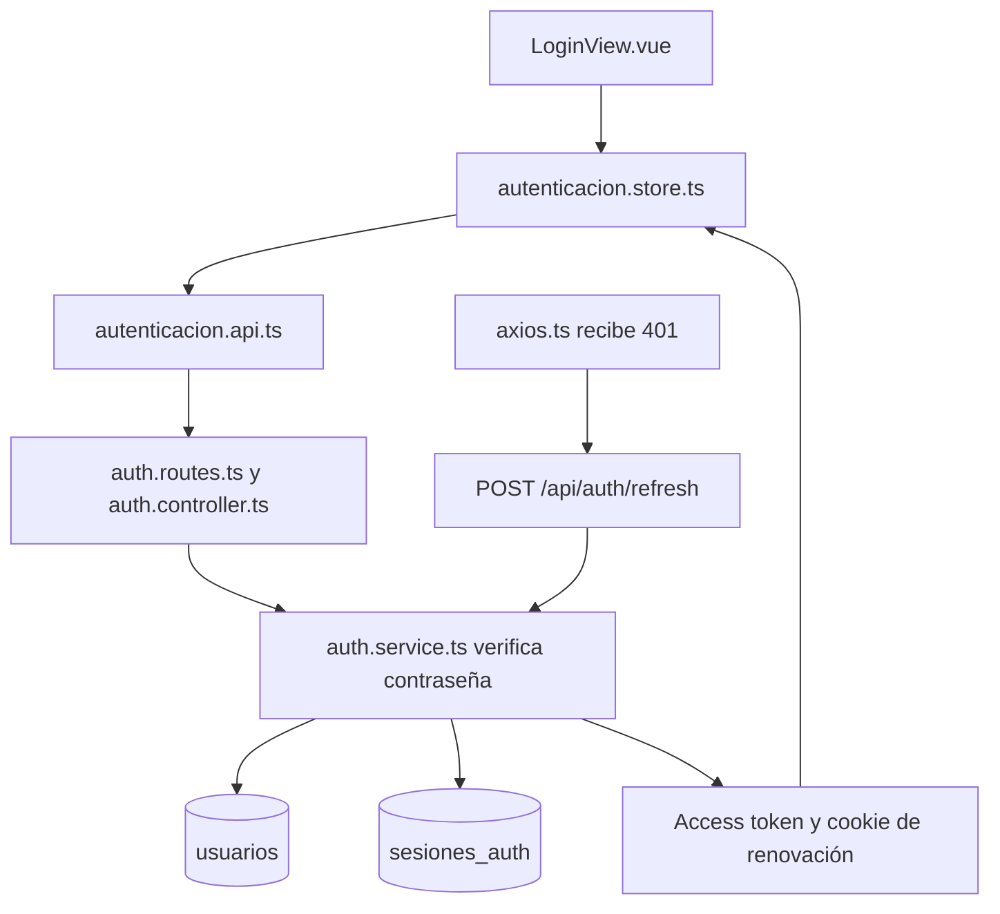

**Archivos que debes abrir**

- Pantalla y estado de sesión. [LoginView.vue](../frontend/src/views/autenticacion/LoginView.vue), [autenticacion.store.ts](../frontend/src/stores/autenticacion.store.ts)
- Peticiones e interceptor. [autenticacion.api.ts](../frontend/src/api/autenticacion.api.ts), [axios.ts](../frontend/src/api/axios.ts)
- Login, cookie y respuesta. [auth.controller.ts](../backend/src/controllers/auth.controller.ts)
- Contraseña, emisión y renovación. [auth.service.ts](../backend/src/services/auth.service.ts)
- Usuarios y sesiones persistentes. [auth.repository.ts](../backend/src/repositorios/auth.repository.ts), [sesiones.repository.ts](../backend/src/repositorios/sesiones.repository.ts)
- Verificación de identidad y rol. [auth.middleware.ts](../backend/src/middlewares/auth.middleware.ts)

**Recorrido para explicarlo**

1. El store envía correo y contraseña al endpoint `POST /api/auth/login`.
2. `iniciarSesion` busca al usuario, comprueba que esté activo y verifica bcrypt.
3. El servidor emite un access token de 15 minutos y un refresh token de 7 días.
4. El access token vive en memoria del store. El refresh viaja en una cookie HttpOnly.
5. La base almacena el hash SHA-256 del refresh token. La renovación rota ese hash.
6. Axios añade `Authorization` y coordina una renovación compartida cuando varias
   peticiones reciben 401. Logout revoca la sesión persistida.

**Si el profesor pide cambiar algo**

| Petición | Punto de cambio | Qué revisar junto con él |
| --- | --- | --- |
| Cambiar el tiempo de sesión | `construirSesion` y `crearRefreshToken` en el servicio | `maxAge` de la cookie en el controlador |
| Cambiar el mensaje de login | `iniciarSesion` del store | Mensajes y estados HTTP del controlador |
| Impedir acceso a una cuenta desactivada | Middleware y consultas de usuario | Login y renovación también consultan su estado |
| Explicar por qué se recupera la sesión al recargar | `restaurarSesion` del store | La cookie permite obtener otro access token |

## 2. Registro y administración de usuarios

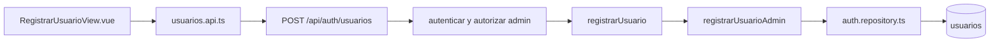

La pantalla administrativa registra estudiantes o profesores. El controlador
valida campos, fechas y rol. El servicio valida la carrera de los estudiantes y
genera el hash de contraseña. Correo y cédula tienen restricciones de unicidad.

- Formulario y contrato. [RegistrarUsuarioView.vue](../frontend/src/views/autenticacion/RegistrarUsuarioView.vue), [usuarios.api.ts](../frontend/src/api/usuarios.api.ts)
- Validación de entrada y creación. [auth.controller.ts](../backend/src/controllers/auth.controller.ts), [auth.service.ts](../backend/src/services/auth.service.ts), [auth.repository.ts](../backend/src/repositorios/auth.repository.ts)
- Administración de cuentas de administrador. [control-admin.ts](../backend/src/scripts/control-admin.ts)

El registro público está disponible en `POST /api/auth/register` y asigna el rol
estudiante. Los administradores se gestionan mediante el script de administración.

**Ejemplo de cambio**. Para agregar un dato obligatorio, sigue el campo por el
formulario, `NuevoUsuario`, el esquema Zod del controlador, los tipos del
repositorio y el INSERT. Una nueva columna también necesita una migración.

## 3. Facultades, carreras y pénsum

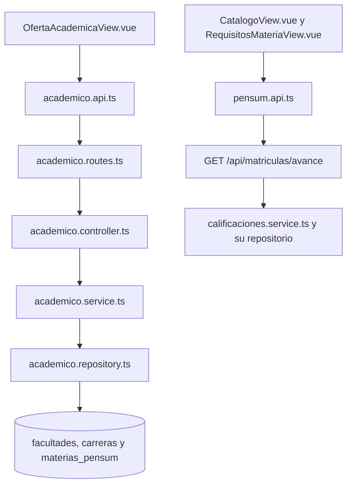

- Consulta de oferta y plan del estudiante. [OfertaAcademicaView.vue](../frontend/src/views/academico/OfertaAcademicaView.vue), [CatalogoView.vue](../frontend/src/views/academico/CatalogoView.vue), [RequisitosMateriaView.vue](../frontend/src/views/academico/RequisitosMateriaView.vue)
- Contratos. [academico.api.ts](../frontend/src/api/academico.api.ts), [pensum.api.ts](../frontend/src/api/pensum.api.ts)
- Oferta académica. [academico.service.ts](../backend/src/services/academico.service.ts), [academico.repository.ts](../backend/src/repositorios/academico.repository.ts)
- Datos originales y alcance. [oferta-academica.md](oferta-academica.md)

Los endpoints de facultades, carreras y pénsum consultan el catálogo. El avance
del estudiante combina el plan con sus calificaciones y prerrequisitos. La función
SQL `materia_del_programa` se utiliza para decidir qué materias pertenecen a su plan,
incluida la compatibilidad con estudiantes anteriores sin carrera asignada.

La matrícula consulta directamente la tabla `prerrequisitos_materia`.

**Ejemplo de cambio**. Para agregar una carrera, revisa facultad, carrera,
asignaturas y prerrequisitos en la base mediante una migración nueva. Después
verifica el registro, el catálogo, el avance y la apertura de grupos de esa carrera.

## 4. Cursos, grupos y asignación docente

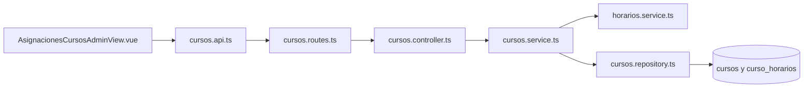

- Pantalla y editor de sesiones. [AsignacionesCursosAdminView.vue](../frontend/src/views/academico/AsignacionesCursosAdminView.vue), [SesionesHorarioEditor.vue](../frontend/src/components/academico/SesionesHorarioEditor.vue)
- Comunicación y creación. [cursos.api.ts](../frontend/src/api/cursos.api.ts), [cursos.controller.ts](../backend/src/controllers/cursos.controller.ts), [cursos.service.ts](../backend/src/services/cursos.service.ts)
- SQL y asignación docente. [cursos.repository.ts](../backend/src/repositorios/cursos.repository.ts)

Una asignatura es parte del pénsum. Un curso representa un grupo concreto de esa
asignatura, con docente, cupos y sesiones. Una asignatura puede tener varios grupos.

`POST /api/cursos` crea un grupo y `PUT /api/cursos/:id/docente` cambia su docente.
Ambas operaciones requieren administrador. El servicio comprueba que el profesor
esté activo. La creación guarda curso y sesiones dentro de una transacción y usa
un bloqueo asesor para generar el código del grupo.

**Ejemplo de cambio**. Para permitir más sesiones semanales, revisa el límite del
editor y `esquemaSesiones` en `horarios.service.ts`. Para cambiar la generación
del código de grupo, abre `crearCurso` en el repositorio y conserva su coordinación
frente a creaciones simultáneas.

## 5. Matrícula y consultas

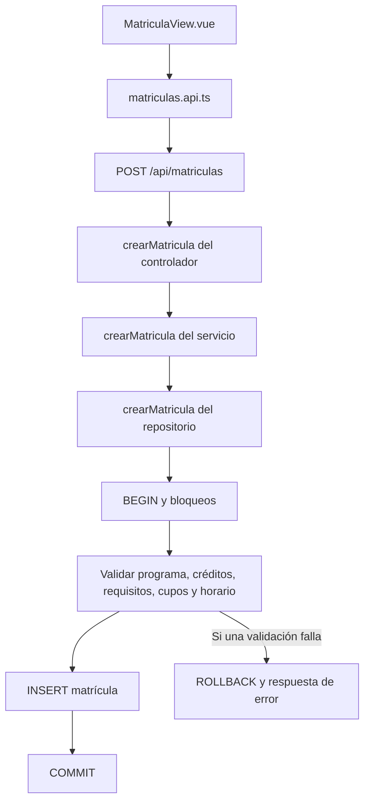

- Selección y resultados parciales. [MatriculaView.vue](../frontend/src/views/matriculas/MatriculaView.vue)
- Consulta administrativa. [MisMatriculasView.vue](../frontend/src/views/matriculas/MisMatriculasView.vue)
- Comunicación y catálogo compartido. [matriculas.api.ts](../frontend/src/api/matriculas.api.ts), [cursos.store.ts](../frontend/src/stores/cursos.store.ts)
- Entrada HTTP y coordinación. [matriculas.controller.ts](../backend/src/controllers/matriculas.controller.ts), [matriculas.service.ts](../backend/src/services/matriculas.service.ts)
- Validaciones atómicas. [matriculas.repository.ts](../backend/src/repositorios/matriculas.repository.ts)

**Reglas que debes poder explicar**

- El servicio comprueba que el usuario sea un estudiante activo y que exista el curso.
- El repositorio detecta el reintento de una matrícula existente del periodo y
  devuelve ese registro. La unicidad también tiene protección en la base.
- Bloquea la fila del estudiante para coordinar su saldo de créditos y sus grupos.
- Verifica pertenencia a la carrera, revisión del plan y créditos disponibles.
- Bloquea el curso para coordinar los cupos de solicitudes simultáneas.
- Revisa materia ya aprobada, prerrequisitos, capacidad y cruces de horario.
- Registra la matrícula dentro de la transacción y revierte ante un error.

El frontend confirma una petición por curso. Una selección de varios cursos puede
producir éxitos parciales. Los cursos pendientes se conservan en la selección de
la vista mientras esa vista permanezca cargada.

La consulta de cupos calcula disponibilidad restando matrículas activas del periodo
al límite almacenado en `cursos.cupos_disponibles`. Al explicar un cambio de cupos,
revisa tanto esa consulta como la validación transaccional.

| Operación | Endpoint |
| --- | --- |
| Confirmar un grupo | `POST /api/matriculas` |
| Mis matrículas | `GET /api/matriculas/mias` |
| Matrículas del periodo para administrador | `GET /api/matriculas/admin/todas` |
| Eliminar matrícula propia del periodo | `DELETE /api/matriculas/:id` |

La eliminación está disponible en el backend. La interfaz actual concentra la
selección y la consulta de matrículas.

**Ejemplo de cambio**. Para permitir matricular una materia previamente aprobada,
localiza `MATERIA_YA_APROBADA` en el repositorio y la condición `motivoBloqueoCurso` de
la vista. Evalúa también cómo quedarán representadas las notas de un nuevo intento.

## 6. Créditos y solicitudes

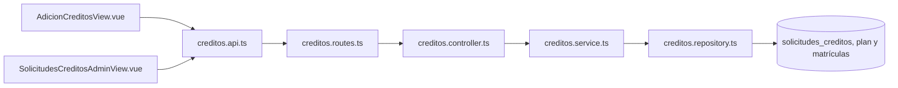

- Solicitud y decisión administrativa. [AdicionCreditosView.vue](../frontend/src/views/matriculas/AdicionCreditosView.vue), [SolicitudesCreditosAdminView.vue](../frontend/src/views/matriculas/SolicitudesCreditosAdminView.vue)
- API y reglas. [creditos.api.ts](../frontend/src/api/creditos.api.ts), [creditos.service.ts](../backend/src/services/creditos.service.ts)
- Saldo, consultas y actualización de estado. [creditos.repository.ts](../backend/src/repositorios/creditos.repository.ts)

El saldo disponible se obtiene con `máximo de 0 y créditos base + extras aprobados
− créditos matriculados`. Los créditos base se calculan usando el avance académico
y el plan del estudiante. El periodo se calcula con la fecha de PostgreSQL.

Las solicitudes pasan por `Pendiente`, `Aprobada` o `Rechazada`. El servicio valida
cantidad y motivo. Un índice parcial permite una solicitud pendiente por estudiante
y periodo. La decisión actualiza únicamente una solicitud todavía pendiente.

**Ejemplo de cambio**. Si el profesor fija otro límite de créditos, revisa
`obtenerResumenCreditos` y la consulta de balance dentro de `crearMatricula`.
Actualizar ambos mantiene coherencia entre lo mostrado y lo que se permite guardar.

## 7. Calificaciones y avance académico

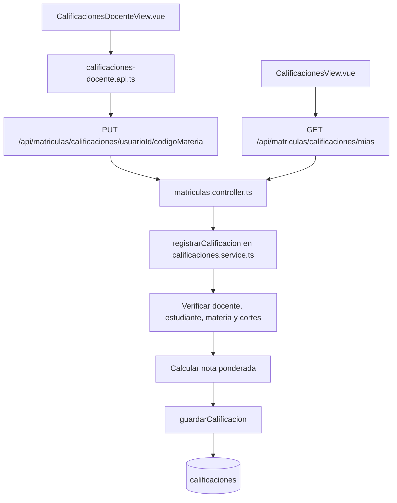

- Registro y consulta. [CalificacionesDocenteView.vue](../frontend/src/views/calificaciones/CalificacionesDocenteView.vue), [CalificacionesView.vue](../frontend/src/views/calificaciones/CalificacionesView.vue)
- Contratos. [calificaciones-docente.api.ts](../frontend/src/api/calificaciones-docente.api.ts), [calificaciones-estudiante.api.ts](../frontend/src/api/calificaciones-estudiante.api.ts)
- Validación y cálculo. [calificaciones.service.ts](../backend/src/services/calificaciones.service.ts)
- Lectura y guardado. [calificaciones.repository.ts](../backend/src/repositorios/calificaciones.repository.ts)

El profesor selecciona uno de sus cursos y consulta sus estudiantes. El backend
comprueba la asignación mediante `docenteId` y que el estudiante pertenezca a uno
de sus grupos de esa materia. El administrador también puede registrar notas
mediante el endpoint autorizado.

Los tres cortes deben estar entre 0 y 5 y tener como máximo un decimal. La nota
final usa `corte1 × 0.3 + corte2 × 0.3 + corte3 × 0.4`, redondeada a dos decimales.
El repositorio inserta o actualiza la calificación de estudiante y materia.

El avance considera aprobada una asignatura con nota desde `3.0`. El registro
actual identifica la calificación por estudiante y materia. Un requisito de
historial de intentos o notas por periodo implicaría revisar ese modelo.

**Ejemplo de cambio**. Para usar ponderaciones 20 %, 30 % y 50 %, cambia la fórmula
del servicio y los textos de ambas pantallas. Decide si la nueva ponderación se
aplica a futuros guardados o requiere recalcular notas existentes.

**Otra pregunta frecuente**. Si cambia la nota mínima de aprobación, busca `3.0`
en los repositorios de calificaciones, matrículas y créditos. Esa condición afecta
el avance, los prerrequisitos y el semestre usado para calcular el saldo.

## 8. Horarios

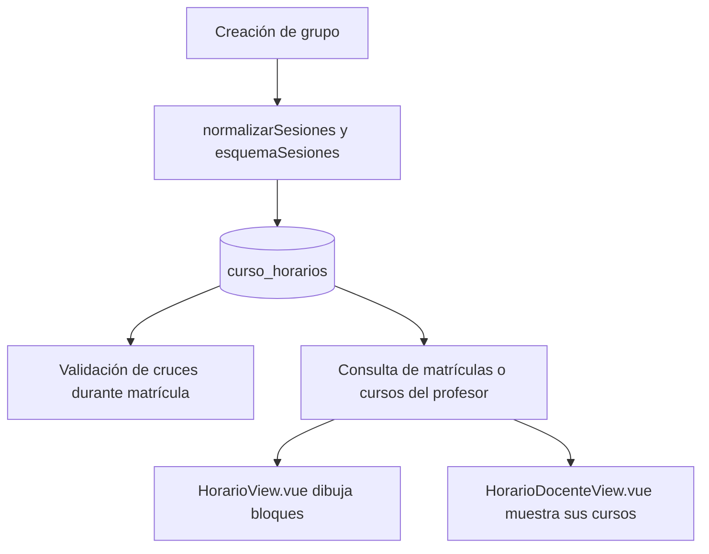

- Pantallas. [HorarioView.vue](../frontend/src/views/horarios/HorarioView.vue), [HorarioDocenteView.vue](../frontend/src/views/horarios/HorarioDocenteView.vue)
- Sesiones y representación textual. [horarios.service.ts](../backend/src/services/horarios.service.ts)
- Cruces y consulta del estudiante. [matriculas.repository.ts](../backend/src/repositorios/matriculas.repository.ts)
- Consulta de cursos. [cursos.repository.ts](../backend/src/repositorios/cursos.repository.ts)

Las sesiones tienen día ISO de 1 a 7, hora de inicio y hora de fin. El servicio
admite hasta 21 sesiones y rechaza intervalos invertidos o superpuestos dentro
del mismo grupo. El repositorio de matrículas consulta las sesiones actuales de
la base para decidir si el estudiante tiene un cruce.

Dos intervalos se cruzan cuando el inicio de cada uno es anterior al final del
otro, dentro del mismo día. Una clase que termina justo cuando empieza otra se
permite. Un curso sin sesiones revisadas provoca `HORARIO_PENDIENTE_REVISION`.

**Ejemplo de cambio**. Para dibujar franjas de media hora, revisa `horas` y
`crearBloques` en `HorarioView.vue`, junto con las filas del CSS. La validación
de matrícula utiliza las horas almacenadas, independientemente del dibujo.

## 9. Datos personales y foto

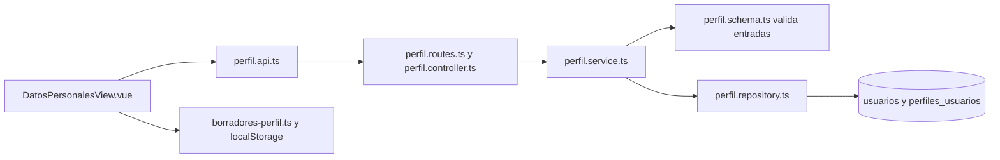

- Pantallas y contrato. [DatosPersonalesView.vue](../frontend/src/views/perfil/DatosPersonalesView.vue), [perfil.api.ts](../frontend/src/api/perfil.api.ts)
- Validación y coordinación. [perfil.schema.ts](../backend/src/schemas/perfil.schema.ts), [perfil.service.ts](../backend/src/services/perfil.service.ts)
- Persistencia y borradores. [perfil.repository.ts](../backend/src/repositorios/perfil.repository.ts), [borradores-perfil.ts](../frontend/src/services/borradores-perfil.ts)

Las rutas de perfil requieren estudiante. La identidad se toma del usuario
autenticado. Nombre, correo y nacionalidad se actualizan en `usuarios` y los datos
de contacto se guardan en JSONB de `perfiles_usuarios`, dentro de una transacción.

Edad, semestre y estudio se consultan como datos calculados o académicos. El
frontend los excluye del cuerpo de actualización. Los esquemas estrictos del
backend rechazan campos extra.

El estudiante agrega o quita su foto en Datos personales. La foto se valida
como PNG, JPEG o WebP de hasta 1 MB, incluyendo sus bytes de identificación.
Los borradores del navegador se recuperan explícitamente y están separados por usuario.

**Ejemplo de cambio**. Para agregar un dato de contacto, revisa el formulario, el
tipo `DatosPersonales` de la API y `esquemaDatos`. Si pertenece al JSON de contacto,
la persistencia existente admite ese objeto. Si requiere una columna propia,
añade su migración y modifica las consultas correspondientes.

## 10. Soporte docente

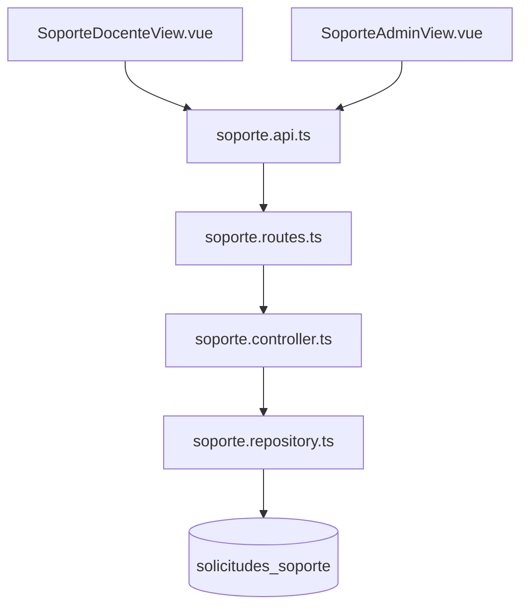

- Pantallas y peticiones. [SoporteDocenteView.vue](../frontend/src/views/soporte/SoporteDocenteView.vue), [SoporteAdminView.vue](../frontend/src/views/soporte/SoporteAdminView.vue), [soporte.api.ts](../frontend/src/api/soporte.api.ts)
- Texto, identidad y consultas. [soporte.controller.ts](../backend/src/controllers/soporte.controller.ts), [soporte.repository.ts](../backend/src/repositorios/soporte.repository.ts)

El profesor envía y consulta sus solicitudes con `/api/soporte/mias`. El
administrador consulta `/api/soporte/admin` y responde mediante PATCH a una
solicitud concreta. Mensaje y respuesta deben tener entre 5 y 2000 caracteres.
La actualización de respuesta exige que la solicitud siga sin respuesta.

**Ejemplo de cambio**. Para permitir varias respuestas por solicitud, revisa la
estructura actual de una sola respuesta en `solicitudes_soporte`. El cambio
requiere modelar los mensajes, actualizar los endpoints y mostrar la conversación
en ambas pantallas.

## 11. Navegación, roles y componentes

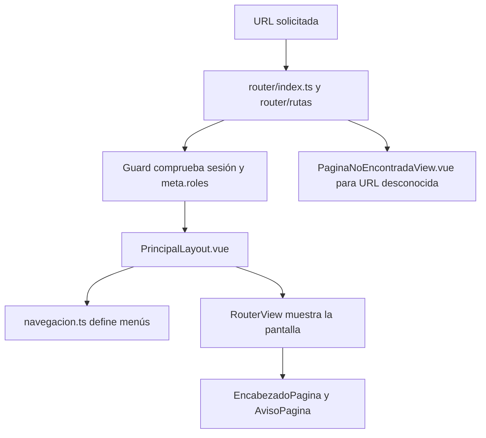

- Rutas, guard y destino inicial. [router/index.ts](../frontend/src/router/index.ts), [router/rutas](../frontend/src/router/rutas), [inicio.ts](../frontend/src/router/inicio.ts)
- Menú y estructura común. [PrincipalLayout.vue](../frontend/src/layouts/PrincipalLayout.vue), [navegacion.ts](../frontend/src/layouts/navegacion.ts)
- Error de navegación. [PaginaNoEncontradaView.vue](../frontend/src/views/PaginaNoEncontradaView.vue)
- Apariencia compartida. [base.css](../frontend/src/assets/base.css), [EncabezadoPagina.vue](../frontend/src/components/ui/EncabezadoPagina.vue), [AvisoPagina.vue](../frontend/src/components/ui/AvisoPagina.vue)
- Catálogo y actualización. [TarjetaCurso.vue](../frontend/src/components/TarjetaCurso.vue), [FiltrosCursos.vue](../frontend/src/components/FiltrosCursos.vue), [useActualizacionCursos.ts](../frontend/src/composables/useActualizacionCursos.ts)

El layout privado tiene roles por defecto y las rutas docentes y administrativas
declaran sus permisos específicos. Las pantallas de inicio usan el rol para
orientar al usuario. El backend valida los permisos en cada operación protegida.

**Ejemplo de cambio**. Para agregar una pantalla al menú, registra su ruta,
declara sus roles y añade la opción en `navegacion.ts`. Si consume una operación
restringida, revisa la autorización del endpoint correspondiente.

## Base de datos y configuración

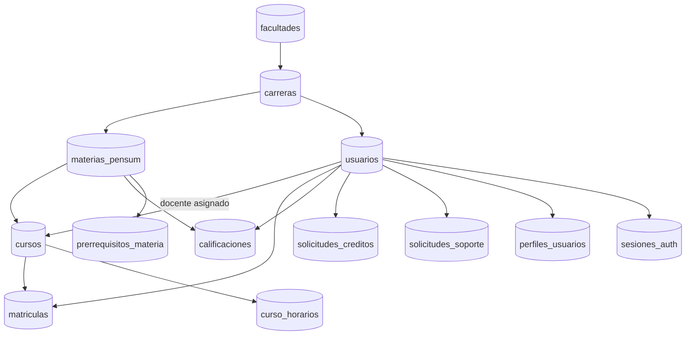

Las flechas resumen relaciones de consulta y claves entre entidades. Las cuentas
de estudiante, profesor y administrador comparten la tabla `usuarios`.

| Pregunta | Archivo o carpeta |
| --- | --- |
| Dónde configurar la conexión | [database.ts](../backend/src/config/database.ts) y `backend/.env` |
| Dónde configurar puerto, origen y secretos JWT | [env.ts](../backend/src/config/env.ts) |
| Dónde configurar la URL que llama el frontend | `frontend/.env`, variable `VITE_API_URL`, y [axios.ts](../frontend/src/api/axios.ts) |
| Dónde configurar CORS y tamaño de JSON | [app.ts](../backend/src/app.ts) |
| Dónde comprobar si falta esquema | [schema.ts](../backend/src/config/schema.ts) |
| Dónde ordenar y aplicar migraciones | [migraciones.ts del catálogo](../backend/src/database/migraciones.ts), [migraciones.ts del ejecutor](../backend/src/scripts/migraciones.ts) |
| Dónde definir nuevas tablas o columnas | [database/migrations](../backend/src/database/migrations) |
| Dónde convertir excepciones en respuestas | [error.middleware.ts](../backend/src/middlewares/error.middleware.ts) y [http-error.ts](../backend/src/types/http-error.ts) |

El periodo académico se calcula en varias consultas SQL con año y semestre
calendario. Enero a junio produce `-1` y julio a diciembre produce `-2`.
Un cambio de calendario requiere revisar cursos, matrículas, créditos,
calificaciones y el valor por defecto de nuevas matrículas.

## Simulacro de preguntas

| Pregunta del profesor | Respuesta breve que puedes desarrollar | Primer punto de búsqueda |
| --- | --- | --- |
| ¿Dónde empieza una petición? | En la acción de la vista, seguida por su función API y el endpoint Express | Vista y `.api.ts` del dominio |
| ¿Cómo sabes quién está conectado? | El middleware verifica JWT y el estado actual de la cuenta | `autenticar` |
| ¿Cómo evitas que un estudiante registre notas? | La ruta autoriza roles y el servicio valida al registrador | Ruta de calificaciones y `registrarCalificacion` |
| ¿Dónde cambias 30/30/40? | En la fórmula del servicio y en los textos de las pantallas | `calificaciones.service.ts` |
| ¿Dónde cambias la nota mínima de aprobación? | En las consultas que identifican aprobadas y calculan avance y créditos | Buscar `3.0` en los repositorios |
| ¿Por qué una materia aparece bloqueada? | Puede tener requisitos pendientes, estar aprobada o tener un plan pendiente de verificación | `obtenerAvancePensum` y `motivoBloqueoCurso` |
| ¿Cómo evitas sobrepasar los cupos? | La transacción bloquea el curso y comprueba su ocupación actual | `FOR UPDATE` en matrícula |
| ¿Cómo evitas sobrepasar créditos con dos peticiones? | Se coordina la operación bloqueando la fila del estudiante | `crearMatricula` del repositorio |
| ¿Qué ocurre si falla el tercer curso de una selección? | Las peticiones anteriores pueden haberse guardado y la vista conserva los pendientes | `matricular` en `MatriculaView.vue` |
| ¿Qué ocurre si se reintenta el mismo grupo? | Se devuelve la matrícula existente del periodo o actúa la restricción de unicidad | `crearMatricula` e índice de matrícula |
| ¿Cómo detectas un choque de horario? | Se comparan intervalos del mismo día usando las sesiones actuales | Buscar `CRUCE_HORARIO` |
| ¿Cómo cambias el diseño del horario? | Cambiando la generación de bloques y el CSS de la pantalla | `crearBloques` en `HorarioView.vue` |
| ¿Cómo cambias el color principal? | Cambiando las variables CSS compartidas y revisando estilos específicos | `assets/base.css` |
| ¿Cómo agregas otra opción de menú? | Registrando su ruta, permisos y opción de navegación | `router/rutas` y `navegacion.ts` |
| ¿Cómo agregas un rol nuevo? | Revisando la restricción de la base, tipos de rol, autorización, inicio y menús | `usuarios`, `RolUsuario` y `RolUsuario` del frontend |
| ¿Cómo agregas otro dato al perfil? | Siguiendo el dato por formulario, contrato, esquema y persistencia | `DatosPersonalesView.vue` y `esquemaDatos` |
| ¿Cómo cambias el tamaño máximo de foto? | Ajustando la validación de cliente, esquema de imagen y límite JSON coherentemente | `DatosPersonalesView.vue`, `perfil.schema.ts` y `app.ts` |
| ¿Cómo cambias el PDF? | Ajustando el servicio de PDF y su consulta cuando cambia el contenido | `generarResumenPdf` |
| ¿Dónde se guarda la respuesta de soporte? | En la solicitud, junto con administrador y fecha de respuesta | `responderSolicitudSoporte` |
| ¿Cómo agregas una columna? | Creando una migración nueva y actualizando lectura, escritura y contrato | `database/migrations` y catálogo de migraciones |

## Cómo comprobar un cambio

Explica el resultado esperado antes de editar. Ubica la entrada de la funcionalidad,
la validación que decide el resultado y la persistencia que puede verse afectada.
Después sigue la respuesta de vuelta a la pantalla.

| Funcionalidad | Pruebas existentes que conviene revisar |
| --- | --- |
| Login, renovación y usuarios | [autenticacion.test.ts](../frontend/tests/autenticacion.test.ts), [auth.test.ts](../backend/tests/auth.test.ts), [sesiones.test.ts](../backend/tests/sesiones.test.ts), [acceso.test.ts](../backend/tests/acceso.test.ts) |
| Matrícula y renovación HTTP | [matriculas.test.ts](../frontend/tests/matriculas.test.ts), [auth.test.ts](../backend/tests/auth.test.ts), [grupos.test.ts](../backend/tests/grupos.test.ts) |
| Oferta, carrera y creación de grupos | [academico.test.ts](../backend/tests/academico.test.ts), [oferta.test.ts](../backend/tests/oferta.test.ts) |
| Horarios y cruces | [horarios.test.ts](../backend/tests/horarios.test.ts) |
| Perfil | [perfil.test.ts del frontend](../frontend/tests/perfil.test.ts), [perfil.test.ts del backend](../backend/tests/perfil.test.ts) |
| Soporte | [soporte.test.ts](../backend/tests/soporte.test.ts) |
| Navegación y menús | [navegacion.test.ts](../frontend/tests/navegacion.test.ts) |
| Respuestas ante fallos | [errores.test.ts](../backend/tests/errores.test.ts) |

Los comandos y requisitos para ejecutar estas verificaciones están en la
[guía de desarrollo](desarrollo.md). Esta guía se preparó mediante lectura estática
del proyecto. Sus recorridos describen el código y las pruebas existentes.

### Una forma de responder durante la defensa

«Eso pertenece a la funcionalidad de calificaciones. La pantalla envía los cortes
mediante su API. El controlador valida la petición y el servicio comprueba permisos
y calcula la nota. El repositorio guarda el resultado. Para cambiar las ponderaciones,
modificaría la fórmula, actualizaría los textos y comprobaría el guardado y la consulta
de la nueva nota».

Usa esa estructura para las demás preguntas, nombrando la pantalla, el endpoint,
la regla y la persistencia que participan en el cambio solicitado.
